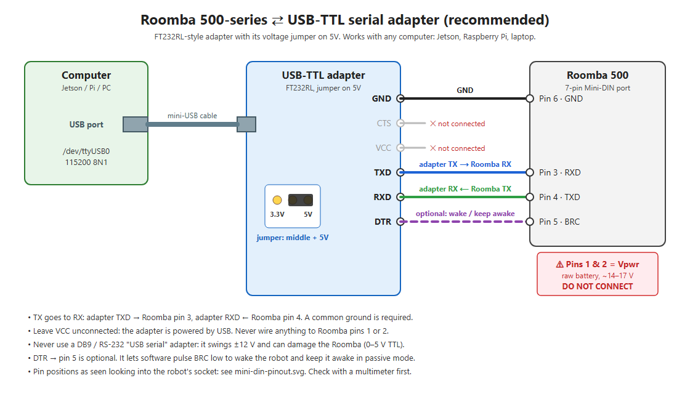
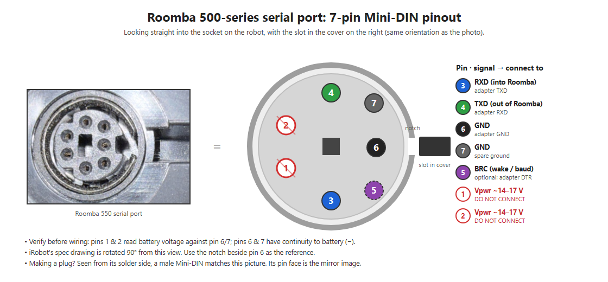

# roomba-serial-ros2

Control an **iRobot Roomba 500-series** (tested on a Roomba 550) over its serial port: wiring
diagrams, an Open Interface reference, a no-ROS command-line tool, and a **ROS 2 Jazzy driver**
that exposes every function the robot supports.

Built and tested with a Jetson Orin Nano Super (Ubuntu 24.04, ROS 2 Jazzy). Everything except the
alternative Jetson-header wiring works on any Linux machine with a USB port.



## Contents

| | |
|---|---|
| [docs/images/](docs/images) | Wiring diagrams (SVG + PNG) and the script that generates them |
| [docs/open-interface.md](docs/open-interface.md) | Opcodes, sensor packets, modes and stream format, with notes from the real robot |
| [docs/troubleshooting.md](docs/troubleshooting.md) | What worked, what didn't, and measurements: level shifters, 3.3 V, baud, sleep, checksums |
| [examples/roomba_cli.py](examples/roomba_cli.py) | Command-line tool: sensors, beep, display text, drive, stop (no ROS needed) |
| [ros2/roomba_driver](ros2/roomba_driver) | ROS 2 driver node plus a standalone Python library (see its [README](ros2/roomba_driver/README.md)) |
| [ros2/roomba_msgs](ros2/roomba_msgs) | Messages and services for the driver |

## Hardware

- Roomba 500 series with the 7-pin Mini-DIN serial port (under the top cover)
- **USB-TTL serial adapter set to 5 V**, e.g. an FT232RL breakout with a 3.3 V/5 V jumper.
  **Not** an RS-232/DB9 adapter.
- A 7-pin Mini-DIN male cable (search "7-pin mini DIN cable" or "iRobot Create 2 serial cable"),
  or jumper wires pushed into the socket for testing
- Optional: one extra wire from the adapter's DTR pin to Mini-DIN pin 5 (BRC), so software can wake
  the robot

## Wiring

| Adapter (jumper on 5V) | Roomba Mini-DIN pin |
|---|---|
| TXD | 3 (RXD) |
| RXD | 4 (TXD) |
| GND | 6 or 7 |
| DTR (optional) | 5 (BRC) |
| VCC | not connected |

**Never connect pins 1 or 2.** They carry raw battery voltage (14–17 V). Check the pin positions with
a multimeter before wiring.



Wiring straight to a Jetson's header pins also works, but the 3.3 V signals are marginal:
see [the alternative diagram](docs/images/wiring-jetson-uart.png) and
[troubleshooting](docs/troubleshooting.md#3-direct-wiring-to-the-jetson-header-worked-but-marginal).

## Quick start without ROS

```bash
pip install pyserial
sudo usermod -aG dialout $USER        # then log out and back in
python3 examples/roomba_cli.py sensors
python3 examples/roomba_cli.py beep
python3 examples/roomba_cli.py display HELLO
python3 examples/roomba_cli.py drive 100 0.5     # ~5 cm forward; robot on the floor with space ahead
```

If nothing responds, the robot is probably asleep. Press **Clean**, then press it again to stop it.

## Quick start with ROS 2 (Jazzy)

```bash
cd ~/ros2_ws/src
git clone https://github.com/Brett-D/roomba-serial-ros2.git
cd ~/ros2_ws && colcon build --packages-select roomba_msgs roomba_driver
source install/setup.bash
ros2 launch roomba_driver roomba_driver.launch.py
```

```bash
ros2 topic pub -r 10 /cmd_vel geometry_msgs/msg/Twist "{linear: {x: 0.1}}"   # Ctrl-C: it stops within 0.5 s
ros2 topic echo /battery_state
ros2 topic echo /roomba/sensors
ros2 topic pub --once /roomba/display std_msgs/msg/String "{data: 'HELLO'}"
ros2 service call /roomba/seek_dock std_srvs/srv/Trigger
```

The driver provides:
- **Drive commands:** `cmd_vel`, arc drive, per-wheel speed and raw motor power.
- **Odometry:** encoder-based on `wheel/odom`, plus `joint_states`.
- **Battery and sensors:** `battery_state`, and every sensor on `roomba/sensors`.
- **Actuators:** cleaning motors, LEDs, scheduling LEDs, the 4-digit display and songs.
- **Behaviours and settings:** clean, spot, max and dock; button presses; the schedule; the clock; and mode changes.

Safety features:
- Starts in Safe mode.
- Stops the wheels if commands stop arriving or contact with the robot is lost.
- Hands the robot back in passive mode on exit.

The full list is in the [driver README](ros2/roomba_driver/README.md).

## Key findings

- **115200 baud.** The older SCI manual's 57600 is for pre-500 robots.
- Use **131 (Safe)** for control. Safe mode is **refused while the robot is lifted or on its charger**,
  and every motor command then gets error beeps.
- In passive mode the robot **sleeps after 5 minutes**; streaming doesn't keep it awake.
- **Encoders** (packets 43/44) are accurate and count down in reverse. The firmware's distance/angle
  packets were not.
- Streaming every sensor at once (84-byte frames) gives **bad checksums in Safe mode**. Frames of
  70 bytes or less are clean.
- The 4-digit display works through 164 (ASCII).

## References

- iRobot, *Roomba 500 Open Interface Specification*:
  [PDF](https://hacksterio.s3.amazonaws.com/uploads/attachments/1249529/irobot_roomba_500_open_interface_spec_MiXdaXg0Xl.pdf)
- iRobot, *Roomba Serial Command Interface (SCI) Specification* (2005, pre-500 robots: different
  baud rate and opcodes)

## License

[Apache-2.0](LICENSE). Not affiliated with or endorsed by iRobot. iRobot and Roomba are trademarks of
iRobot Corporation.
