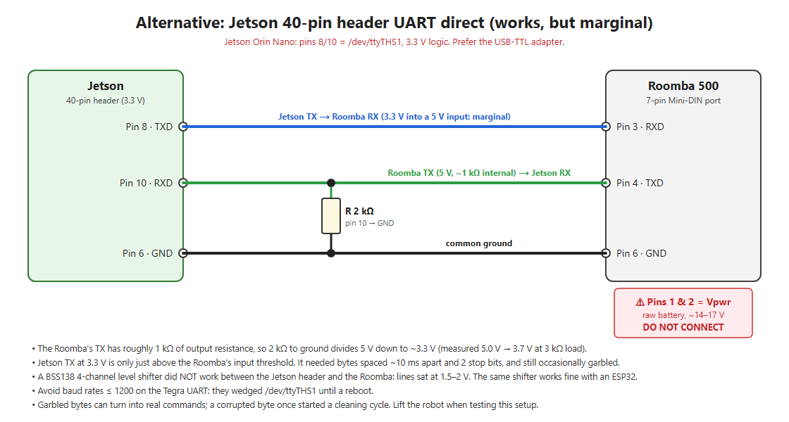
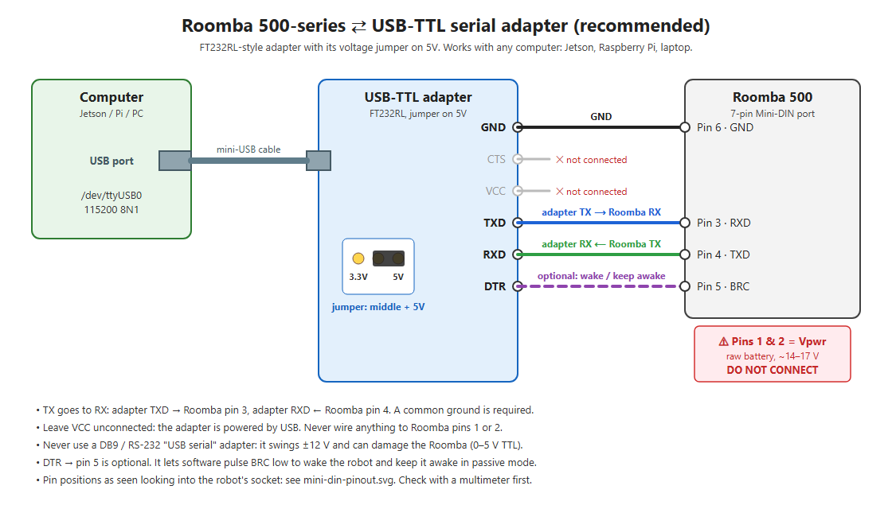

# Troubleshooting and lessons learned

Everything here was measured on a Roomba 550, connected first to a Jetson Orin Nano's 40-pin header and then through an
FT232RL USB-TTL adapter.

## Quick symptom table

| Symptom | Likely cause | Fix |
|---|---|---|
| No reply at all, robot lights off | Robot is asleep. In passive mode it sleeps after 5 min idle. | Press **Clean**, then press again to stop it. Or wire adapter DTR → pin 5 and pulse BRC low for 1 s. |
| No reply, lights on | TX/RX swapped, no common ground, wrong baud, or an RS-232 (DB9) adapter | TXD → pin 3, RXD ← pin 4, GND → pin 6; 115200 8N1; use a **TTL** adapter. |
| You hear the **power-up tune** when sending | Bytes at the wrong baud rate were decoded as a reset | Use 115200. |
| Low **error beeps** for every motor/LED command, no motion | Robot is still in passive: Safe mode was refused | Put the wheels on the floor, off the dock. Check packet 35 = 2. |
| Safe mode refused | Wheels lifted (wheel drop), cliff sensors see nothing (robot held in the air), or on the charger | Set it down on the floor, away from the dock. |
| Robot starts cleaning or spinning by itself during tests | A corrupted byte became a Clean/Spot opcode (marginal 3.3 V TX) | Use a 5 V adapter. Lift the robot while testing marginal wiring. |
| Sensor values jump around, wrong bits | Marginal receive levels (3.3 V input, divider) | Use a 5 V USB-TTL adapter. |
| Display text stays after the program ends | The digit LEDs latch | Send `164` with four spaces before returning to passive. |
| Firmware distance/angle (packets 19/20) say −6 mm after a 50 mm move | Known-flaky packets on 500 firmware | Use encoder counts (43/44). They're accurate and count down in reverse. |
| ~10% bad stream frames in Safe mode | 84-byte frames (group 100) are too big for the firmware in Safe mode | Keep frames ≤ ~70 bytes. The driver rotates two smaller layouts. |
| `/dev/ttyTHS1` won't open: `Failed to enable FIFO mode: -110` | A baud rate ≤ 1200 wedged the Tegra UART | Reboot the Jetson, and avoid very low baud rates. |
| Wires fell out while the robot drove | Jumper wires pushed into the Mini-DIN socket | Use a 7-pin Mini-DIN plug or cable, or tape/glue the wires in place. |

## The connection journey (what worked and what didn't)

### 1. DB9 "USB serial" adapters: don't

RS-232 adapters swing about ±12 V. The Roomba's port is 0–5 V TTL. You need a **TTL** adapter with bare pins.

### 2. BSS138 4-channel level shifter on the Jetson header: didn't work

The common blue 4-channel bidirectional shifter boards with 10 kΩ pull-ups sat between the Jetson (3.3 V) and the
Roomba (5 V):

| Test | Result |
|---|---|
| Jetson pin 8 jumpered straight to pin 10 (loopback) | ✅ Pass, so the Jetson UART and software are fine |
| Loopback through the shifter (HV1 jumpered to HV2) | ❌ Garbage |
| HV1 with Jetson TX held low (break) | **2 V**: the line never went low |
| LV2/HV2 idle with Jetson pin 10 attached | **1.5 V**: pin 10 pulls the line down |

The Jetson header pins couldn't drive the shifter's pull-ups. The **same shifter works fine with an ESP32**, so an
ESP32 bridge (USB serial ⇄ ESP32 ⇄ shifter ⇄ Roomba) is a valid workaround.

### 3. Direct wiring to the Jetson header: worked, but marginal

- **Receive:** the Roomba's TX has roughly 1 kΩ of internal output resistance. It measured 5.0 V unloaded and
  3.7 V with a 1 kΩ + 2 kΩ divider attached, which left only **2.6 V** at the Jetson. Using **only a 2 kΩ resistor
  from pin 10 to GND** puts about 3.3 V on pin 10.
- **Transmit:** 3.3 V is just above the Roomba's input threshold. Commands only got through reliably with **each
  byte sent separately, about 10 ms apart, with 2 stop bits**. Even then, garbled bytes occasionally triggered
  cleaning cycles.

### 4. USB-TTL adapter at 5 V: solid ✅

An FT232RL breakout with its jumper on **5V** fixed everything at once. Six consecutive sensor reads came back
byte-identical (they had been noisy before), no byte spacing was needed, and there were no unexpected movements.

## Waking the robot and keeping it awake

- In passive mode the robot sleeps after **5 minutes** without activity. Streaming sensor data **doesn't** count as
  activity.
- Safe and Full modes don't sleep. The ROS driver starts in Safe mode for this reason.
- BRC (pin 5) low wakes the robot. iRobot's guidance is a **1 s low pulse every minute** to keep it awake.
  **Avoid repeated 50–500 ms pulses**: three of them in a row switch the robot to 19200 baud.
- With the adapter's DTR wired to pin 5, set `wake_with_dtr: true` in the driver.

## Baud rate

The Roomba 550 talks at **115200** after power-up. iRobot's older *SCI* manual (2005, pre-500 series) says 57600.
That doesn't apply here. A baud sweep that plays a different number of beeps per rate is a quick way to find the
right one: only the correct rate beeps, and wrong rates sometimes play the power-up (reset) tune.

## Safe testing habits

- **Lift the robot**, so the wheels hang free, while testing anything that might send motion by accident.
  Note that this also blocks Safe mode.
- Keep drive tests short and slow: 100 mm/s for 0.5 s is about 5 cm.
- Always send `137 0 0 0 0` or `145 0 0 0 0` to stop, and return to passive with `128` so the buttons work again.
- Leave slack in the cable; the robot pulled the wires out of the socket once.
